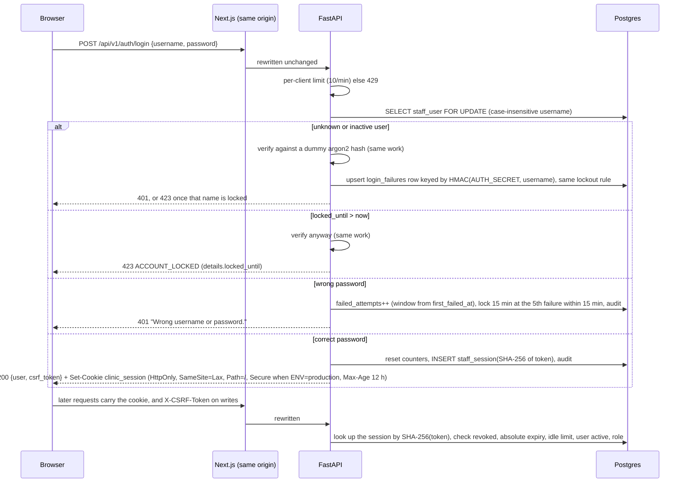

# API Architecture and Staff Authentication

The FastAPI service exposes `/api/v1` to the staff dashboard only. Patients never call the API: they use Telegram, and the bot process calls the same Python service layer in-process. The service layer, not the transport, is therefore where every business rule lives (BRD §3.8: bot and dashboard share one booking service); authorization is enforced by FastAPI dependencies in front of it. The exact request and response shapes are in the contract, [`../api/staff-api.md`](../api/staff-api.md). Audited against the code on 2026-11-05 (commit 3938155); paths are relative to `apps/backend/src/clinic/` unless they start with `apps/`.

## Conventions

- The API process binds to `127.0.0.1` only (`api/__main__.py`, port `API_PORT`, default 8000). The browser talks only to the Next.js origin, which rewrites `/api/v1/*` to the API (`apps/web/next.config.ts`), so no CORS is needed and the API port is never exposed to the browser.
- Versioned under `/api/v1`; JSON. OpenAPI (`/api/v1/openapi.json`) and Swagger UI (`/api/v1/docs`) are served **only when `ENV=development`** (`api/app.py`).
- One error envelope everywhere: `{"error": {"code": "SLOT_TAKEN", "message": "…", "request_id": "…", "details": {…}}}` (`details` only when there are any). Validation errors list field paths, never the submitted values. No stack traces or internals reach clients: an unhandled exception becomes `500 ERROR` and is logged with its type and code location only.
- Lists that can grow (`/faq`, `/staff-users`, `/audit`) use `page`/`page_size` (maximum 100) and return the total. There is no cursor pagination.
- Every response carries `X-Request-ID`: the incoming value when it matches `^[A-Za-z0-9-]{8,64}$`, otherwise a new one. It is bound into the structured logs and into the audit rows written during that request (IMP-11). The request log records method, path, status and latency, never the query string.
- Health: `GET /healthz` (process up) and `GET /readyz` (a `select 1` within 5 s, else 503). Both are outside `/api/v1`, need no session and expose no detail.
- API responses carry `X-Content-Type-Options: nosniff`, `Referrer-Policy: no-referrer`, `Content-Security-Policy: default-src 'none'; frame-ancestors 'none'` and `Cache-Control: no-store`.

## Endpoint catalogue

R = receptionist, A = admin (an admin can do everything a receptionist can). Every endpoint except login and the health checks requires a session.

| Method & path | Role | Purpose | Source |
|---|---|---|---|
| POST `/auth/login` | public, 10 attempts per minute per client | Username + password → session cookie and CSRF token; lockout rule | E6-S1-AC1/AC3 |
| POST `/auth/logout` | R | Revoke the session | E6-S1 |
| GET `/auth/me` | R | Current user, role, CSRF token | E6-S1-AC1 |
| GET `/schedule?date=` | R | Every active doctor's appointments that day: time, patient name, phone, status, source, reminder status, patient-confirmed, staff-attention flag | E6-S2-AC1/AC2 |
| GET `/clinic/today` | R | Today's date in the clinic time zone, so the dashboard never relies on the PC clock | D-40 |
| GET `/attention` | R | Open handoff tickets, unacknowledged emergency alerts, flagged appointments | E6-S2-AC3, E4-S4-AC2 |
| GET `/doctors?active=` | R | Doctors (optionally only active ones) | E6-S4, IMP-01 |
| GET `/availability?doctor_id=&date=` | R | Free slots, from the same service as the bot tool | E6-S4 |
| POST `/patients/lookup` | R | Exact match on a phone number sent in the body; never a listing of all patients. Replaced `GET /patients?phone=` so the number stays out of URLs and logs | E6-S4-AC1, D-41 |
| POST `/appointments` | R | Staff booking for an existing patient or a new walk-in with recorded verbal consent → `source = staff` | E6-S4-AC1/AC2 |
| POST `/appointments/{id}/cancel` | R | With a reason; queues a patient notice when a Telegram link exists; not bound by the bot's cut-off | E6-S4-AC3, E4-S4-AC1, GAP-21 |
| POST `/appointments/{id}/attendance` | R | `completed` or `no_show`, only after the start time; changing an existing mark is admin-only | E6-S5, GAP-22 |
| POST `/appointments/{id}/clear-attention` | R | Staff have called the patient | E4-S4-AC2 |
| POST `/tickets/{id}/resolve` | R | Saves status, resolver and time | E5-S4-AC2 |
| POST `/alerts/{id}/acknowledge` | R | Saves who acknowledged and when | E5-S3-AC3 |
| POST `/doctors`, PATCH `/doctors/{id}` | A | Add a doctor; edit name, specialty, active flag | IMP-01 |
| GET/PUT `/doctors/{id}/schedule` | A | Read or replace the weekly pattern (several blocks per weekday = breaks); validated | E6-S3-AC1/AC2 |
| GET `/doctors/{id}/leaves` | A | Leave days | E6-S3 |
| POST `/doctors/{id}/leaves/preview` | A | Booked appointments a leave day would affect | E6-S3-AC3 |
| POST `/doctors/{id}/leaves` | A | Records leave; with `confirm_affected: true` it cancels the affected bookings and queues notices | E6-S3-AC3, E4-S4 |
| DELETE `/doctors/{id}/leaves/{leave_id}` | A | Remove a leave day | E6-S3 |
| GET/POST `/faq`, PATCH/DELETE `/faq/{id}` | A | Approved clinic information | IMP-02, E5-S1-AC3 |
| GET/PATCH `/settings` | A | Clinic settings | IMP-05 |
| GET `/audit?from=&to=&actor_type=&action=&patient_id=` | A | Paginated, read-only | E7-S2-AC3, IMP-03 |
| GET `/metrics/weekly?week_start=` | A | Bookings by source, cancellations, no-show rate per doctor; zeros when empty | E6-S6 |
| GET/POST `/staff-users`, PATCH `/staff-users/{id}`, POST `/staff-users/{id}/unlock` | A | Provisioning, role, deactivation, password reset, unlock | IMP-04 |

Every write endpoint adds an audit row with `actor_type = 'staff'` and the staff user's id in the same transaction as the change (GAP-18). Logins (success, failure, lockout) and logouts are audited too.

## Staff authentication flow (D-08)

- **Passwords:** argon2id with the `argon2-cffi` defaults, hashed in a worker thread; at least 12 characters; re-hashed on login when the parameters change (NFR-04). The same 401 message is returned for unknown users and wrong passwords, and unknown users cost the same hashing work, so usernames cannot be enumerated by message or timing.
- **Lockout:** the 5th failure within 15 minutes locks the account for 15 minutes, so the 6th attempt is refused (E6-S1-AC3). Unknown usernames are locked the same way through `login_failures` (migration 0003). An admin can unlock an account (`POST /staff-users/{id}/unlock`). On top of that, logins are limited to 10 per minute per client address (the browser's address taken from `X-Forwarded-For` when the request comes from the loopback rewrite); this limiter is in the API process's memory.
- **Sessions:** an opaque random token (`secrets.token_urlsafe(32)`) in the HttpOnly cookie `clinic_session`, stored only as its SHA-256; a new token at every login. **12 hours absolute and 60 minutes idle.** These are constants in `services/staff_auth.py` (`SESSION_ABSOLUTE`, `SESSION_IDLE`), not `.env` settings. Activity (`last_seen_at`) is written at most once a minute, so the idle limit is accurate to about a minute. Logout, deactivation and a password reset (which revokes all of that user's sessions) take effect on the next request.
- **Idle timeout and background polls (D-29):** the dashboard refreshes the Today screen and the attention panel every 30 s. Any `GET` sent when the user has not clicked, typed, scrolled or touched for 60 s carries `X-Background-Refresh: 1`; the API authenticates such requests but does not count them as activity, so an unattended reception screen still signs out after 60 minutes (`api/deps.py`, `apps/web/lib/api/client.ts`).
- **CSRF:** the CSRF token is HMAC-SHA256 keyed with the session token, so it is bound to the session and needs no storage (`services/staff_auth.py` `csrf_token_for`). It is returned by `POST /auth/login` and `GET /auth/me`, kept in the dashboard's memory only, and required as `X-CSRF-Token` on every request other than `GET`, `HEAD` and `OPTIONS`; it is compared in constant time. A missing or wrong token gets `403 FORBIDDEN` with `details.reason = "csrf"` (D-30), and the dashboard then refreshes the token and retries once. The `SameSite=Lax` cookie is a second layer.
- **Authorization** is enforced in FastAPI dependencies: `current_staff` (session + CSRF) and `require_admin` (`api/deps.py`). The dashboard also hides admin screens, but the UI is never the enforcement point (E6-S1-AC4, E7-S2-AC3).
- **Dashboard headers** (`apps/web/next.config.ts`, every non-API path): CSP with `default-src 'self'`, `script-src 'self' 'unsafe-inline'` (plus `'unsafe-eval'` in development only; the inline scripts are an accepted residual risk, D-42), `object-src 'none'`, `frame-ancestors 'none'`; `X-Frame-Options: DENY`, `X-Content-Type-Options: nosniff`, `Referrer-Policy: no-referrer`, `Cross-Origin-Opener-Policy: same-origin`, and a restrictive `Permissions-Policy`. **No HSTS is sent** by either process: the laptop deployment is plain HTTP (D-05); HSTS belongs on an HTTPS terminator if there ever is one.
