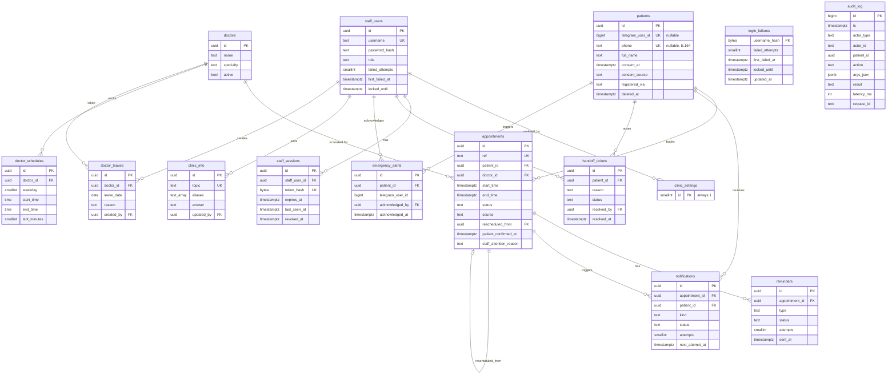

# Database Design

Engine: PostgreSQL on hosted Supabase (D-02), reached through the session pooler with asyncpg (D-25). Migrations: **Alembic is the single source of truth** (`apps/backend/migrations/versions/0001_baseline.py`, `0002_patients_deleted_anonymised.py`, `0003_login_failures.py`; head is `0003`). All timestamps are `timestamptz` stored in UTC; the clinic time zone (settings `timezone`) is used only for slot generation, day boundaries and display. Tables live in schema `clinic` (dev) and, for tests, `clinic_test` (D-17); the table definitions name no schema and SQLAlchemy's `schema_translate_map` maps them at runtime (`apps/backend/src/clinic/db/session.py`).

The source asks for SQLite in development (§3.7, DM-11). **The build is Postgres-only** (D-02, D-25): the exclusion constraint below and the `ON CONFLICT` statements in the services do not exist in SQLite.

Sources: DM-00..11 (§3.6), ACs cited per rule, IMP-* (derived, see `docs/requirements/requirements-inventory.md` §14). Columns marked **(IMP)** are not in the source data model and were added to satisfy a cited AC. Audited against the migrations on 2026-11-05.

## ERD

`login_failures` has no foreign key: it holds lockout state for usernames that do not exist (migration 0003).

## Tables

Enums are `CHECK` constraints on `text` columns rather than native enum types, because they are easier to change in reversible migrations. No foreign key cascades except `staff_sessions → staff_users`; the application deletes only schedule blocks, leave days, FAQ entries and stale lockout rows. Patients are anonymised and staff users deactivated, never deleted.

### patients — DM-01, E1, IMP-14
| Column | Type | Rules |
|---|---|---|
| id | uuid PK | `gen_random_uuid()` |
| telegram_user_id | bigint NULL | UNIQUE (DM-01). NULL for walk-in patients and after deletion |
| phone | text NULL | UNIQUE (DM-01); E.164, CHECK `^\+[1-9][0-9]{6,14}$` |
| full_name | text NULL | CHECK 2–60 characters and no digits (E1-S2-AC3); the service also validates it |
| consent_at | timestamptz NULL | Set when registration completes (E1-S3-AC3) or when staff record verbal consent |
| consent_source | text NULL | `telegram` \| `staff_verbal` (GAP-10) |
| registered_via | text | `bot` \| `staff` |
| created_at, updated_at | timestamptz | |
| deleted_at | timestamptz NULL | E1-S4. Deletion sets `full_name = 'Deleted patient'`, `phone = NULL`, `telegram_user_id = NULL` (GAP-25, `services/patients.py`) |

CHECKs: `ck_patients_identity` = `deleted_at IS NOT NULL OR (phone, full_name, consent_at all NOT NULL)`; `ck_patients_deleted_anonymised` (migration 0002) = `deleted_at IS NULL OR (phone IS NULL AND telegram_user_id IS NULL)`, so a deleted record can never be matched or re-linked. Only name, phone, Telegram ID and appointments are stored, with no health fields (NFR-06).

### doctors — DM-02, IMP-01
`id`, `name` and `specialty` (CHECK 2–80 characters each), `active bool default true`, timestamps. Index `(active)`. Inactive doctors never appear in `list_doctors` (E2-S1-AC2), in availability or on the daily schedule.

### doctor_schedules — DM-03, E6-S3, GAP-09
`id`, `doctor_id`, `weekday smallint CHECK 0..6` (0 = Monday), `start_time time`, `end_time time`, `slot_minutes smallint default 15 CHECK 5..120`, timestamps. CHECK `end_time > start_time` (E6-S3-AC2). Breaks are gaps between several rows for one weekday. Overlaps are rejected by the service (`services/admin.py` `validate_blocks`), which replaces a doctor's whole week in one transaction holding a `FOR UPDATE` lock on the doctor row. Index `(doctor_id, weekday)`.

### doctor_leaves — DM-04
`id`, `doctor_id`, `leave_date date`, `reason text default '' CHECK ≤ 200 characters`, `created_by` (staff user), `created_at`. UNIQUE `(doctor_id, leave_date)`. Full-day leave only, as in the source (E2-S4-AC3).

### appointments — DM-05, E2, E3, E4, E6
| Column | Type | Rules |
|---|---|---|
| id | uuid PK | |
| ref | text UNIQUE | Default `format_appointment_ref(nextval('appointment_ref_seq'))`: `APT-` plus at least 6 zero-padded digits; past 999999 it keeps growing (`APT-1234567`) instead of wrapping (IMP-10, E2-S3-AC2) |
| patient_id | uuid FK | Every patient-facing query filters on it (E3-S1-AC3) |
| doctor_id | uuid FK | |
| start_time, end_time | timestamptz | CHECK `end_time > start_time`; `end_time` is stored so overlaps can be checked after a slot length changes |
| status | text | `booked` \| `cancelled` \| `completed` \| `no_show` (DM-05); transitions enforced in `domain/appointments.py` (IMP-15) |
| source | text | `bot` \| `staff` (DM-05, E6-S4-AC1) |
| rescheduled_from | uuid NULL FK → appointments | E3-S2-AC2 |
| cancelled_at, cancelled_by_kind, cancel_reason | NULL | `patient` \| `staff` \| `system`; reason ≤ 200 characters, shown to the patient in E4-S4. CHECK: a cancelled row has `cancelled_at` and `cancelled_by_kind` |
| patient_confirmed_at | timestamptz NULL | **(IMP-08)** E4-S3-AC1 |
| staff_attention_reason, staff_attention_at | NULL | **(IMP-09)** E4-S4-AC2: `notification_failed` or `reminder_failed`, set when sending fails after its retries |
| created_by_staff_id, attendance_marked_by, attendance_marked_at | NULL | Staff provenance (E6-S4, E6-S5) |
| created_at, updated_at | timestamptz | |

Double-booking defences (BR-03, E2-S4), all in migration 0001:
1. **Required by the source (E2-S4-AC2):** `CREATE UNIQUE INDEX ux_appt_doctor_start_booked ON appointments (doctor_id, start_time) WHERE status = 'booked'`.
2. **Added (REC-DB-01):** `CONSTRAINT ex_appt_no_overlap EXCLUDE USING gist (doctor_id WITH =, tstzrange(start_time, end_time) WITH &&) WHERE (status = 'booked')`, using `btree_gist` (installed into schema `extensions` by `infrastructure/db/bootstrap.sql`). It stops overlapping bookings after an admin changes a slot length (for example a 15-minute slot at 10:00 and a 20-minute slot at 09:50).
3. A violation of either inside the booking transaction maps to `SLOT_TAKEN` (`services/booking.py` `DOUBLE_BOOKING_CONSTRAINTS`). Before inserting, the booking also takes a `FOR UPDATE` lock on the patient row, so one patient's parallel taps cannot exceed the per-patient limits.

Other indexes: `(patient_id, status, start_time)` for own-appointment lists and limits; partial `(start_time) WHERE status = 'booked'` for the reminder scan; `(doctor_id, start_time)` for the daily schedule.

### reminders — DM-06, E4-S1, E4-S2
`id`, `appointment_id`, `type` (`24h` \| `2h`), `status` (`pending` \| `sent` \| `failed` \| `skipped`), `attempts smallint`, `last_error text` (exception type only), `claimed_at`, `sent_at`, `created_at`. **UNIQUE `(appointment_id, type)`** (DM-06, E4-S1-AC3). A reminder is claimed with `INSERT … ON CONFLICT DO NOTHING RETURNING id` **before** it is sent, and only the claimer sends it (`services/reminders.py`). Delivery is therefore at most once: a crash between the claim and the send leaves the row `pending` and that reminder unsent.

### notifications — outbox for clinic-side changes, E4-S4 (IMP)
`id`, `appointment_id`, `patient_id`, `kind` (`clinic_cancelled` \| `doctor_leave`), `reason text`, `status` (`pending` \| `sent` \| `failed`), `attempts`, `next_attempt_at`, `last_error`, `created_at`, `sent_at`. UNIQUE `(appointment_id, kind)`; partial index on `next_attempt_at WHERE status = 'pending'`. The API writes the row in the same transaction as the cancellation or leave, and only when the patient has a Telegram link; the bot's `outbox` job leases due rows with `FOR UPDATE SKIP LOCKED` for 5 minutes and sends them (`services/notifications.py`). Delivery is at least once: a crash after sending but before recording repeats the notice when the lease ends. The API never calls Telegram.

### handoff_tickets — DM-07, E5-S4, IMP-07
`id`, `patient_id`, `reason` (`patient_requested` \| `agent_failed` \| `registration_conflict` \| `change_within_cutoff` \| `other`), `status` (`open` \| `resolved`), `created_at`, `resolved_by` (staff user), `resolved_at`. CHECK: a resolved ticket has `resolved_at`. **Partial UNIQUE `(patient_id) WHERE status = 'open'`** enforces E5-S4-AC3 (no duplicate open ticket) in the database. `reason` is an enum, not model free text, so no health details can land here (NFR-06).

### emergency_alerts — IMP-06, E5-S3-AC3
`id`, `patient_id NULL`, `telegram_user_id bigint NULL` (for unregistered senders), `created_at`, `acknowledged_by NULL`, `acknowledged_at NULL`. CHECK: at least one of `patient_id` and `telegram_user_id`. Partial index on `created_at WHERE acknowledged_at IS NULL`. **No message text is stored.** The dashboard shows name and phone through the patient join. Repeat alerts from one sender within 10 minutes are not stored again (`services/alerts.py`).

### clinic_info — DM-08, E5-S1, IMP-02
`id`, `topic text UNIQUE` (CHECK `^[a-z0-9_]{1,40}$`, e.g. `timings`, `fees`, `address`, `parking`, `what_to_bring`), `aliases text[]`, `answer text` (CHECK 1–2000 characters), `updated_by`, `created_at`, `updated_at`. Edited by admins only. The bot matches a question's topic exactly against the topic or an alias after lower-casing and treating `_` and `-` as spaces; there is no fuzzy matching (`services/faq.py`).

### staff_users — DM-09, E6-S1, IMP-04
`id`, `username` (CHECK 3–40 characters; UNIQUE on `lower(username)`; the service accepts only `a-z 0-9 . _ -`), `display_name`, `password_hash` (argon2id), `role` (`receptionist` \| `admin`), `active`, `failed_attempts`, `first_failed_at` (GAP-23), `locked_until`, `last_login_at`, timestamps.

### staff_sessions — supports E6-S1
`id`, `staff_user_id` (`ON DELETE CASCADE`, indexed), `token_hash bytea UNIQUE` (SHA-256 of a random token from `secrets.token_urlsafe(32)`; the raw token exists only in the HttpOnly cookie), `created_at`, `expires_at`, `last_seen_at`, `revoked_at`. Server-side sessions make logout, deactivation and password resets take effect on the next request.

### login_failures — E6-S1-AC3 for unknown usernames (migration 0003)
`username_hash bytea PK`, `failed_attempts`, `first_failed_at`, `locked_until`, `updated_at` (indexed). Unknown usernames get the same 5-in-15-minute lockout as real accounts, so neither the 423 response nor its timing reveals whether an account exists. The key is HMAC-SHA256 of the normalised username with `AUTH_SECRET` (`services/staff_auth.py` `_unknown_login`), so a database reader cannot test guesses; the migration's own docstring says "SHA-256", but the code uses the keyed HMAC. Rows not updated for a day are purged after failed logins.

### audit_log — DM-10, E7-S2, FR-10
`id bigint GENERATED ALWAYS AS IDENTITY`, `ts`, `actor_type` (`agent` \| `staff` \| `system` \| `patient_button`), `actor_id text` (model name for the agent, staff user id for staff), `patient_id uuid NULL`, `action text` (tool name, or an action such as `appointment.staff_cancel`, `staff.login`), `args_json jsonb` (validated arguments only, never chat text: E7-S2-AC2; `services/audit.py` rejects the keys `text`, `message`, `name`, `phone`, `full_name`), `result text` (result code), `latency_ms int`, `request_id text`. **Append-only:** the app role has its UPDATE and DELETE rights revoked, and the trigger `audit_log_append_only` rejects UPDATE and DELETE even for the owner. Indexes `(ts DESC)`, `(patient_id, ts DESC)`.

### clinic_settings — IMP-05
Single row (`id smallint PK CHECK (id = 1)`): `clinic_name`, `phone`, `address`, `staff_hours_text`, `timezone` (IANA, validated by the API), `emergency_number`, `emergency_phrases text[]`, `cutoff_minutes` (default 120, CHECK 0–10080), `booking_window_days` (default 30, CHECK 1–365), `max_upcoming_per_patient` (default 3), `max_per_doctor_per_day` (default 1), `morning_end` (12:00), `afternoon_end` (17:00, CHECK later than `morning_end`), `updated_by`, `updated_at`. The row is created by the seed script (`apps/backend/scripts/seed.py`) from constants in that script plus `CLINIC_TIMEZONE` from `.env`; admins edit it through `PATCH /settings`. Each process caches it for 30 s (`services/clinic_settings.py`).

## Access control at the database layer

- Three login roles (D-20), created by `infrastructure/db/bootstrap.sql` with `nosuperuser nocreatedb nocreaterole nobypassrls noinherit`:
  - `clinic_migrator` has USAGE + CREATE on both schemas, runs Alembic and owns the tables.
  - `clinic_app` (dev runtime) and `clinic_test_app` (tests) have USAGE on their own schema only; table and sequence rights are granted by migration 0001 through `ALTER DEFAULT PRIVILEGES` (SELECT, INSERT, UPDATE, DELETE); `audit_log` is INSERT/SELECT only. Both have `statement_timeout = 10s` and `idle_in_transaction_session_timeout = 30s`.
  - `postgres` (the project owner) runs the one-time bootstrap and is not used at runtime (D-20, D-21).
- Checked on 2026-11-02 by query through the Supabase MCP: Postgres 17.11; `postgres` is not superuser but has BYPASSRLS and CREATEROLE; `btree_gist` 1.7 is available. That BYPASSRLS is why the app must **not** connect as `postgres`.
- Schema `clinic` is not exposed through Supabase's Data API: the Data API is turned off for the project (D-17). This is a project setting made during setup; no automated test checks it.
- RLS is enabled on every table, with one policy `app_access` granting the app role full access (`USING (true)`). This is defence in depth: if the schema were ever exposed, other roles would see nothing. Isolation between patients is enforced in the service layer (every patient query is scoped to the session's patient ID) and tested (E3-S1-AC3, E7-S4-AC1); Postgres RLS is not used for it, because patients never connect to the database.
- Backups: the Supabase Free plan has **no automatic backups** (supabase.com/pricing, checked 2026-11-02). **No backup or restore procedure is documented yet.**

## Migration and data safety

- Every revision has a working `downgrade()`. `tests/integration/test_migrations.py` downgrades the test schema to base, upgrades to head, and repeats both; it is part of the default pytest run, so CI runs it against its `postgres:17` service container.
- Migrations are applied per schema: `uv run alembic -x schema=clinic upgrade head` and `-x schema=clinic_test`.
- The seed (`apps/backend/scripts/seed.py --target dev|test`) is separate from migrations, refuses to run when `ENV=production`, and is idempotent. It creates the clinic settings row, 3 doctors with weekly patterns (two blocks per working day, i.e. a lunch break), 5 FAQ entries, 8 synthetic patients (fictional `+1 202-555-01xx` numbers, no Telegram ID, verbal consent), and appointments for the past 7 days (completed or no-show) and the next 7 days (booked) (E7-S1-AC3, GAP-16).
- Tests run in schema `clinic_test` as role `clinic_test_app`, which has no rights on `clinic` (D-17; `test_test_role_cannot_reach_the_dev_schema`).

## Implementation notes

- Driver: asyncpg (D-25). Raw SQL text is not affected by `schema_translate_map`, so application code uses SQLAlchemy constructs; tests that need raw SQL qualify the schema explicitly. SQL errors never carry bound values into logs (`hide_parameters=True`).
- Supabase advisors after the baseline migration (2026-11-03): security 0 lints; performance INFO only. "Unindexed foreign keys" lists the staff provenance columns (`updated_by`, `created_by`, `resolved_by`, `acknowledged_by`, `attendance_marked_by`, `created_by_staff_id`), `appointments.rescheduled_from`, `emergency_alerts.patient_id` and `notifications.patient_id`. Those indexes would only speed up deletes or key updates of the referenced row; staff users are deactivated and patients anonymised, never deleted, so they were not added. Revisit if a query starts filtering on one of these columns.
