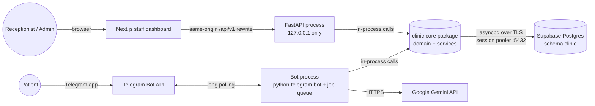
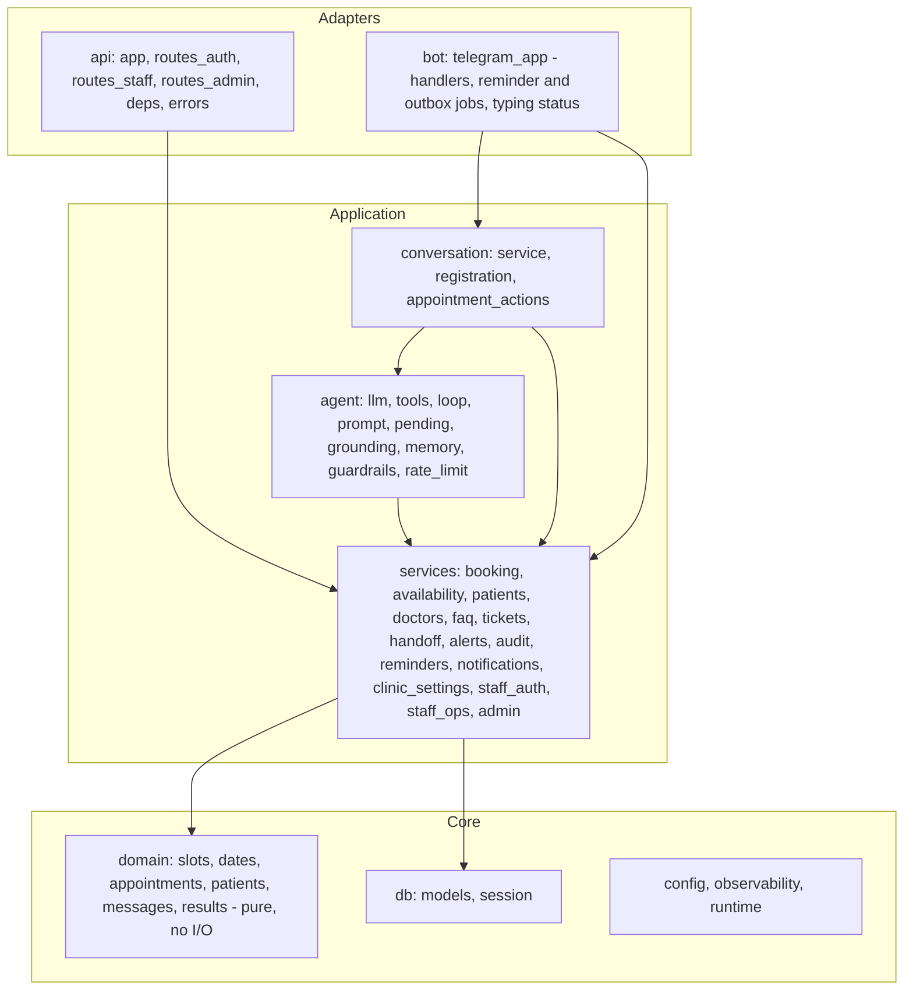
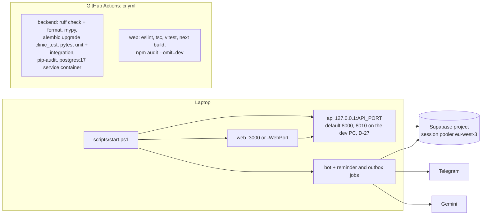

# System Architecture

Rebuilt from BRD §3.4, §3.7 and §3.8 text, because the embedded 10-component diagram (L258) is not in the source file (GAP-02). Stack per D-01 (hybrid: Python core, Next.js dashboard), D-02 (hosted Supabase Postgres), D-03 (Gemini), D-05 (laptop + CI, no live cloud deployment) and D-31 (PowerShell start script instead of Docker Compose). Audited against the code on 2026-11-05 (commit 3938155). Backend paths are relative to `apps/backend/src/clinic/`.

## System context



## Processes

| Process | Tech | Responsibility | Secrets it uses |
|---|---|---|---|
| `web` | Next.js 16 (App Router, TypeScript, Tailwind v4, shadcn/ui, TanStack Query, React Hook Form + Zod) | Staff UI. `next.config.ts` rewrites `/api/v1/*` to `http://127.0.0.1:${API_PORT}`; `proxy.ts` only redirects to `/login` when the session cookie is missing | none (only `API_PORT`) |
| `api` | FastAPI + Pydantic + SQLAlchemy 2 (async) on uvicorn, bound to `127.0.0.1` (`api/__main__.py`) | Staff REST API, authentication, authorization, audit, `/healthz` and `/readyz` | `clinic_app` database password, `AUTH_SECRET` |
| `bot` | python-telegram-bot 22.8 (async, long polling, private chats only) with its job queue (APScheduler) | Patient conversations and the agent loop; job `reminders` every 300 s (E4-S1-AC1) and job `outbox` every 60 s for clinic-side notices (E4-S4); logs `scheduler_heartbeat` on each reminder run | Telegram token, Gemini key, `clinic_app` database password |
| `db` | Supabase hosted Postgres 17 | Source of truth; constraints enforce double-booking and uniqueness rules | — |

Both Python processes load the same `Settings` from the repository-root `.env` (`config.py`), and that class requires every secret, so the API process also has the Telegram token and Gemini key in its configuration. It never uses them: it makes no Telegram or Gemini call.

The scheduler runs **inside the bot process** because sending reminders needs the bot's Telegram client. Reminder idempotency lives in the database (UNIQUE `(appointment_id, type)`): a reminder is claimed before it is sent, so a restart cannot send it twice (NFR-02). The API never sends Telegram messages: it writes `notifications` rows in the same transaction as the staff cancellation or leave, and the bot's `outbox` job sends them (transactional outbox), so a crash cannot lose a notice.

**Single-instance assumption:** one `bot` process, because conversation memory, pending confirmations, registration state and the message rate limiter live in process memory (NFR-07, D-07, GAP-26). The bot handles one update at a time per user and different users concurrently (`bot/telegram_app.py` `UserLocks`). The API keeps its session and lockout state in the database, but its login rate limiter (10 attempts per minute per client) is in process memory, so running several API processes would weaken that limit.

## Backend package layout (`apps/backend/src/clinic`)



Dependency rule, checked against the imports: `domain` imports only `domain`, so it is unit-testable without a database; `db` imports only `config`; `services` import `domain`, `db` and other services; nothing in `services` imports `agent`, `conversation`, `api` or `bot`. One exception: the API reuses `agent/rate_limit.py` for its login limiter. `runtime.py` is the composition root for the bot process; `api/app.py` builds the API's services.

## Repository layout

```
clinic-appointment-agent/
├── apps/
│   ├── backend/              # one Python project: the api and bot processes share the core package
│   │   ├── src/clinic/       # config, observability, runtime, domain, db, services, agent, conversation, bot, api
│   │   ├── migrations/       # Alembic, the single source of truth for the schema (0001..0003)
│   │   ├── scripts/          # seed.py, create_admin.py
│   │   ├── tests/            # unit/, integration/ (includes the evaluation suite), live/
│   │   └── pyproject.toml    # uv-managed, locked in uv.lock
│   └── web/                  # Next.js dashboard: app/, components/, features/, lib/, tests/{unit,e2e}, proxy.ts
├── docs/                     # api, architecture, design, operations, requirements, security, superpowers, testing, tracking
├── infrastructure/db/        # bootstrap.sql (roles, schemas), bootstrap_rollback.sql, ci_prelude.sql, ci_roles.sql
├── scripts/                  # start.ps1, stop.ps1, restart.ps1, check_env.py, db_role_passwords.py
├── .github/workflows/ci.yml
└── .env.example  README.md  PROJECT_TRACKER.md
```

This adapts the master prompt's `apps/api` to `apps/backend`, because the bot shares the API's Python core. A `supabase/` migrations folder is not used: Alembic owns the schema. There is no `docker-compose.yml` (D-31), no `docs/deployment/` and no `SECURITY.md` or `CONTRIBUTING.md`.

## How it runs (D-05, D-31)



- `scripts/start.ps1` builds the dashboard when needed (`-Rebuild` forces it, `-Dev` runs `next dev` instead, D-39), starts the API, the bot and the dashboard in the background, waits for `/readyz`, the dashboard and the first scheduler heartbeat (limit `-TimeoutSeconds`, default 120), writes logs and PIDs to `logs/`, and stops what it started if anything fails. `-NoBot` starts the API and dashboard only. `scripts/restart.ps1 -Part api|bot` restarts one part; `scripts/stop.ps1` stops everything.
- CI runs the migration up/down/up check inside pytest (`tests/integration/test_migrations.py`). **Not in CI:** the Playwright E2E specs, the evaluation suite and the live tests (pytest deselects `live` and `eval` by default, `pyproject.toml`), and secret scanning (SEC-SCAN-01 was a one-off scan before the first push).
- Long polling needs no public URL, which suits a laptop demo (D-18). **A webhook mode is not built or documented** (it would need public HTTPS).
- Backups: the Supabase Free plan includes **no automatic backups** (supabase.com/pricing, checked 2026-11-02). **No backup or restore procedure is documented yet**; the runbook does not cover it.

## Platform facts and pinned choices

Checked on 2026-11-02 against PyPI, npm and the official docs cited in each row, and updated on 2026-11-05 where the build changed a choice. The lockfiles (`uv.lock`, `package-lock.json`) are the reproducible source of truth for versions.

| Topic | Fact | Design consequence | Source |
|---|---|---|---|
| Python | 3.14.3 installed; cp314 wheels exist for the compiled dependencies | Python 3.14 (D-14); `requires-python = ">=3.14"` | pypi.org |
| Gemini SDK | `google-genai` 2.34.0. Async via `client.aio.models.generate_content`; manual function calling with `FunctionDeclaration(parameters_json_schema=…)` and `AutomaticFunctionCallingConfig(disable=True)` | The plain loop of AGT-14 (`agent/llm.py`, `agent/loop.py`). Gemini 3 models reject a follow-up whose history drops the thought signatures, so model turns are replayed from the provider's raw content (checked 2026-11-03, `agent/llm.py`) | github.com/googleapis/python-genai |
| Gemini models | `gemini-3.5-flash-lite` and `gemini-3.8-flash` are stable with function calling and free of charge on the free tier | `GEMINI_MODEL` setting, default `gemini-3.5-flash-lite` (D-13, D-38). A switch to `gemini-3.5-flash` (D-37) was reverted the same day because its free tier allows 20 requests per day | ai.google.dev/gemini-api/docs/models, /pricing |
| Gemini free tier | Content may be used to improve products and read by human reviewers; "Do not submit sensitive, confidential, or personal information to the Unpaid Services." Daily limits are per project and per model: 500 requests per day for `gemini-3.5-flash-lite` (read from the API's 429 reply, QUOTA-01) | **No patient identity is sent to the model** (D-16); free tier only with synthetic data. The bot and the evaluation suite share the 500-request daily quota (acceptance report) | ai.google.dev/gemini-api/terms; QUOTA-01, QUOTA-02 |
| Telegram | PTB 22.8; the `[job-queue]` extra brings APScheduler (3.11.3 locked); `callback_data` 1–64 bytes; `Contact.user_id` is optional | Jobs run on PTB's job queue (BRD §3.7 asks for APScheduler). Callback data stays within 64 bytes (`tests/unit/test_pending.py`). Contact check: `contact_user_id is not None and == sender` | docs.python-telegram-bot.org; core.telegram.org/bots/api |
| Supabase connectivity | The direct host is IPv6-only and did not resolve on the dev PC (D-15a). The shared pooler is IPv4: session mode on 5432, transaction mode on 6543 (no prepared statements). Custom roles log in as `role.<project-ref>` | **Session-mode pooler** with **asyncpg** (D-25, which replaced the psycopg plan of D-15 because psycopg cannot use Windows' default event loop). Session mode keeps one backend per client, so asyncpg's prepared statements are safe. Host `aws-1-eu-west-3.pooler.supabase.com` (D-23) | supabase.com/docs/guides/database/connecting-to-postgres |
| Database TLS | `ssl="require"` encrypts but does not verify the server | verify-full (CA + hostname, TLS ≥ 1.2) when `DB_SSL_ROOT_CERT` is set; production refuses to start without it (D-26, `db/session.py`). The CA is not yet installed on the dev PC, so dev runs use unverified TLS (BLK-05) | security review |
| Supabase security | `public` is exposed through the Data API by default; the Data API can be disabled; custom LOGIN roles can be created; `postgres` has BYPASSRLS | Tables in schema `clinic`; the Data API is turned off for the project (D-17; a setup step, not checked by any test); the app connects as `clinic_app`, which has no BYPASSRLS | supabase.com/docs/guides/database/hardening-data-api, /postgres/roles |
| Supabase Free plan | 2 active projects; paused after 1 week of inactivity; no automatic backups; 500 MB database | **One project** with schemas `clinic` (dev) and `clinic_test` (tests), each with its own role (D-17) | supabase.com/pricing |
| Next.js | `middleware` was renamed to `proxy.ts` in v16; pinned 16.4.4 | Same-origin API via `rewrites` in `next.config.ts`; `proxy.ts` only for the optimistic redirect to `/login` | nextjs.org/docs/app/api-reference/file-conventions/proxy |
| UI libraries | Tailwind 4.3.4; shadcn/ui on Tailwind v4 and React 19; `tw-animate-css` replaces `tailwindcss-animate`; TanStack Query 5.105.3 | As listed in `apps/web/package.json` | npm; ui.shadcn.com/docs/tailwind-v4 |

Checked later: `btree_gist` 1.7 is available on the project and installed into schema `extensions` (`infrastructure/db/bootstrap.sql`), so the exclusion constraint exists; the concurrency test with 10 parallel bookings passes through the pooler (`test_ten_parallel_bookings_for_one_slot_create_exactly_one`). **Not verified:** the Free plan's pooler connection limit, and the Gemini free tier's per-minute limit for this project.

## Cross-cutting concerns

| Concern | Approach | Source |
|---|---|---|
| Configuration | `pydantic-settings` reads the repository-root `.env` (`config.py`); validated at startup (time zone, schema separation, turn budget ≥ model-call timeout); `.env.example` lists every key with dummy values | NFR-03, E7-S1-AC2 |
| Logging | JSON lines via structlog with `request_id`; the keys `phone`, `full_name`, `name`, `text`, `message`, `token`, `password`, `api_key`, `authorization`, `cookie` are replaced by `[redacted]` (`observability.py`); `httpx` request logging is silenced because Telegram URLs carry the bot token; the API logs the path without the query string | NFR-11, NFR-06 |
| Audit | `audit_log` is append-only (trigger + revoked UPDATE/DELETE), written for every tool call, staff write, login, lockout and logout; arguments are checked so they never contain `text`, `message`, `name`, `phone` or `full_name` (`services/audit.py`) | FR-10, E7-S2, GAP-18 |
| Time | UTC in storage; the clinic time zone from `clinic_settings` for slots, dates and display labels; the dashboard takes "today" from `GET /api/v1/clinic/today` (D-40) | A7 |
| Errors | Result codes from the services map to the API error envelope (`api/errors.py`) or to a patient-friendly message; any unexpected error gets a fallback reply with the clinic phone number (`conversation/service.py` `_guarded`) | MP §11 |
| Timeouts and retries | Model call 8 s, whole turn 25 s (D-34); reminder sends: first attempt plus 3 retries after 2, 4 and 8 s; notices: 3 attempts, waiting 1 and then 5 minutes; database: connect 10 s, command 15 s, pool checkout 10 s, and role settings `statement_timeout = 10s`, `idle_in_transaction_session_timeout = 30s` (`bootstrap.sql`); readiness probe 5 s; dashboard requests 15 s | E1-S1-AC3, E4-S1-AC4 |
| Health | `GET /healthz` (process up) and `GET /readyz` (database answers within 5 s, else 503); the bot logs `scheduler_heartbeat` on every reminder run | MP §9 |
