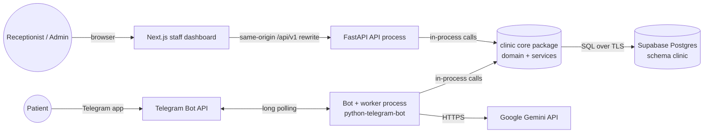
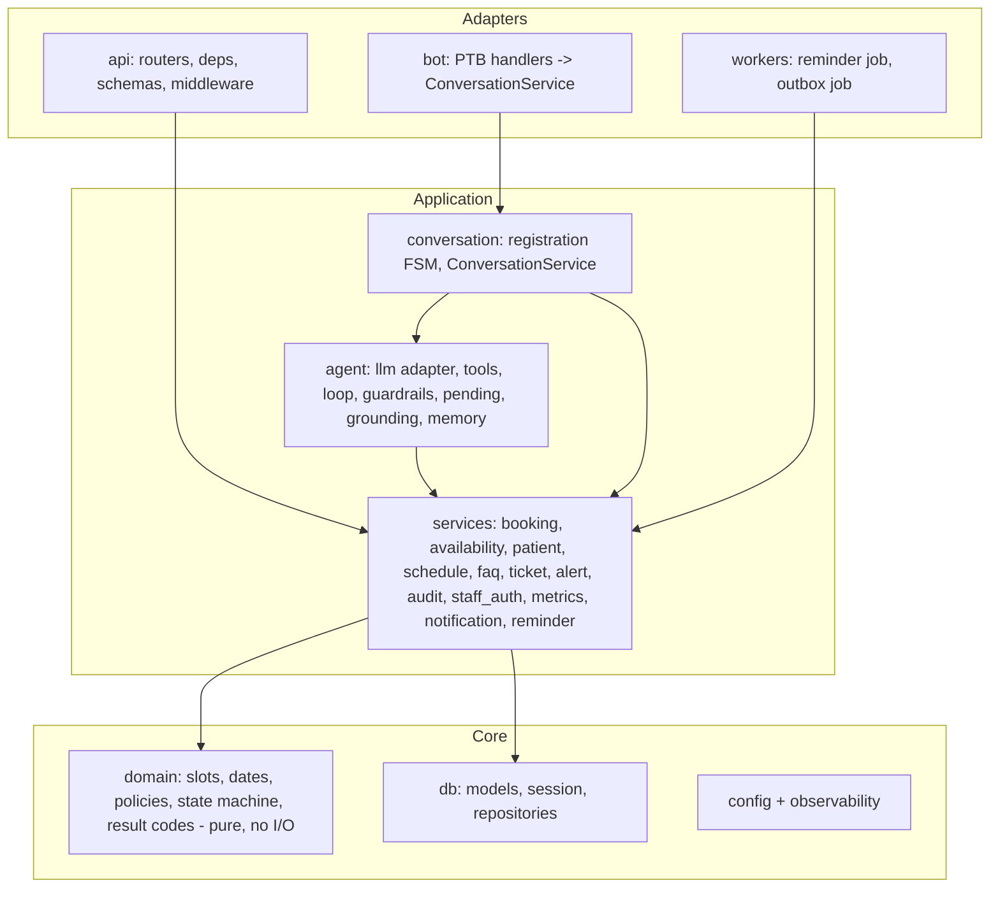
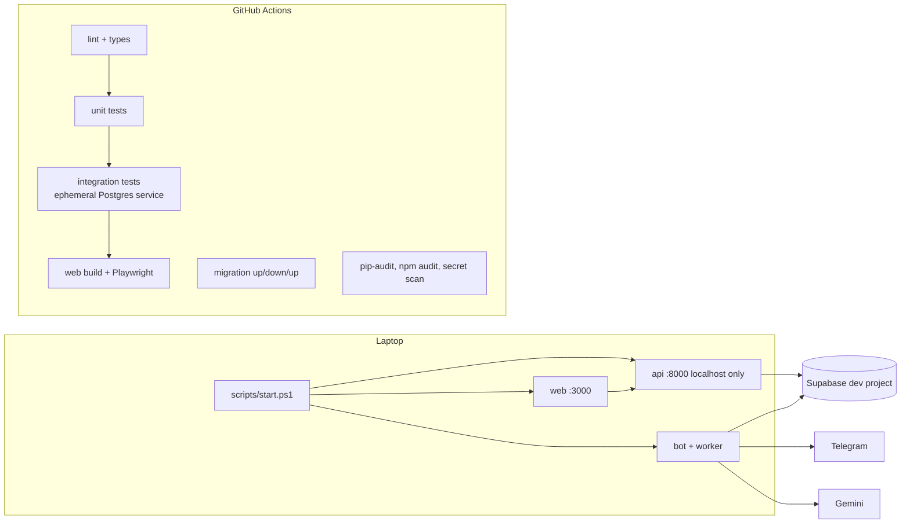

# System Architecture

Rebuilt from BRD §3.4, §3.7 and §3.8 text, because the embedded 10-component diagram (L258) is not in the source file (GAP-02). Stack per D-01 (hybrid), D-02 (hosted Supabase), D-03 (Gemini), D-05 (laptop + Compose + CI).

## System context



## Containers / processes

| Process | Tech | Responsibility | Holds secrets |
|---|---|---|---|
| `web` | Next.js (App Router, TypeScript, Tailwind, shadcn/ui, TanStack Query, React Hook Form + Zod) | Staff UI; rewrites `/api/v1/*` to `api` | none |
| `api` | FastAPI + Pydantic + SQLAlchemy 2 (async) | Staff REST API, auth, authorization, audit | DB URL, session secret |
| `bot` | python-telegram-bot (async, long polling) + scheduled jobs | Patient conversations, agent loop, reminders every 5 min (E4-S1), notification outbox drain (E4-S4) | Telegram token, Gemini key, DB URL |
| `db` | Supabase hosted Postgres | Source of truth; constraints enforce double-booking and uniqueness rules | — |

The scheduler runs **inside the bot process** because sending reminders needs the bot's Telegram client. That keeps one owner of the Telegram token. Reminder idempotency lives in the database (unique `(appointment_id, type)`), so restarts cannot duplicate reminders (NFR-02). The `api` process never sends Telegram messages: it writes `notifications` rows in the same transaction as the staff change, and the bot drains them (outbox). This is least privilege and loses nothing on a crash.

**Single-instance assumption:** one `bot` process (in-memory conversation state, rate limits and pending confirmations, per NFR-07 and D-07). `api` is stateless and could scale horizontally.

## Backend package layout (`apps/backend/src/clinic`)



Dependency rule: arrows point inward only. `domain` imports nothing from the project, which makes it unit-testable without a database. Adapters contain no business rules.

## Repository layout

```
clinic-appointment-agent/
├── apps/
│   ├── backend/            # one Python project: api, bot, workers share the core package
│   │   ├── src/clinic/     # config, observability, domain, db, services, agent, conversation, bot, workers, api
│   │   ├── migrations/     # Alembic (single source of truth for schema)
│   │   ├── scripts/        # seed, create-admin
│   │   ├── tests/          # unit/, integration/, eval/
│   │   └── pyproject.toml  # uv-managed, pinned lockfile
│   └── web/                # Next.js dashboard (app/, components/, features/, lib/, tests/)
├── docs/                   # requirements, architecture, design, api, security, testing, deployment, tracking, final
├── scripts/start.ps1       # one-command local start (E7-S6)
├── docker-compose.yml      # same stack in containers (needs Docker; not verifiable on this machine)
├── .github/workflows/ci.yml
├── .env.example  README.md  SECURITY.md  CONTRIBUTING.md  PROJECT_TRACKER.md
```

This adapts the master prompt's `apps/api` to `apps/backend`, because the bot and workers share the API's Python core. A separate `supabase/` migrations folder is not used: Alembic owns the schema.

## Deployment (D-05)



- Long polling needs no public URL, which suits a laptop demo. Webhook mode, for a future cloud deployment, is described in `docs/deployment/` (needs public HTTPS).
- The evaluation suite needs the Gemini key, so in CI it runs only on manual dispatch with a repository secret.
- Backups: the Supabase Free plan includes **no automatic backups** (supabase.com/pricing, verified 2026-11-02). The runbook documents `pg_dump` export and restore; paid plans add daily backups.

## Platform facts and pinned choices (verified 2026-11-02)

Versions were read live from PyPI and npm. Behaviour comes from official docs; each row cites its source. These are the versions the scaffold starts from. The lockfiles (`uv.lock`, `package-lock.json`) become the reproducible source of truth.

| Topic | Verified fact | Design consequence | Source |
|---|---|---|---|
| Python | 3.14.3 installed. cp314 Windows wheels exist for sqlalchemy 2.1.6, asyncpg 0.32.0, psycopg-binary 3.3.6, pydantic-core; pure wheels with 3.14 classifiers for fastapi 0.162.0, alembic 1.20.1, python-telegram-bot 22.8, apscheduler 3.11.3, structlog 26.1.0, pytest 9.2.0 | Target **Python 3.14** (D-14). httpx 0.28.1 declares classifiers only up to 3.12 (pure Python; checked by our test run) | pypi.org/project/&lt;name&gt; |
| Gemini SDK | `google-genai` 2.34.0, Python ≥ 3.11. Async via `client.aio.models.generate_content`. Manual function calling: `types.FunctionDeclaration(parameters_json_schema=…)`, `AutomaticFunctionCallingConfig(disable=True)`, read `response.function_calls`, reply with `Part.from_function_response` | Matches the planned plain loop (AGT-14) | github.com/googleapis/python-genai |
| Gemini models | Stable models with function calling: `gemini-3.8-flash`, `gemini-3.5-flash-lite` (the latter positioned for high-volume agentic use where latency and cost dominate). Both are free of charge on the free tier | Model is an env setting (`GEMINI_MODEL`). Started with `gemini-3.5-flash-lite` (D-13); since 2026-11-05 the default is `gemini-3.5-flash` (D-37: its own free-tier quota and steadier latency, measured) | ai.google.dev/gemini-api/docs/models, /pricing |
| Gemini free tier | Content is used to improve products; human reviewers may read it; "Do not submit sensitive, confidential, or personal information to the Unpaid Services." Rate limits are shown only in AI Studio, per project | **No patient identity is sent to the LLM** (D-16). The free tier is limited to synthetic-data development and evaluation. Any pilot with real patients requires the paid tier and a DPDP review. Quota may limit eval runs (risk R-GEM-01) | ai.google.dev/gemini-api/terms, /docs/rate-limits |
| Telegram | PTB 22.8; `[job-queue]` extra brings APScheduler `>=3.10.4,<3.12` (AsyncIOScheduler); `callback_data` 1–64 bytes; `Contact.user_id` is optional | Reminder job uses PTB JobQueue, i.e. APScheduler (BRD §3.7). Callback tokens ≤ 64 bytes. Contact check: `user_id is not None and == sender` | docs.python-telegram-bot.org; core.telegram.org/bots/api |
| Supabase connectivity | Direct connections are IPv6-only without the IPv4 add-on. The shared pooler is IPv4 on every plan: session mode on port 5432, transaction mode on 6543. Transaction mode does not support prepared statements. Custom roles connect as `role.[project-ref]` | Connect through the **session-mode pooler** with **psycopg 3 async** (`prepare_threshold=None`, which also works in transaction mode) (D-15) | supabase.com/docs/guides/database/connecting-to-postgres; psycopg.org |
| Supabase security | `public` is exposed through the Data API by default; the Data API can be disabled; custom LOGIN roles can be created; `postgres` has BYPASSRLS | Tables in schema `clinic`; **turn the Data API off** (we don't use it); app connects as `clinic_app`, which has no BYPASSRLS | supabase.com/docs/guides/database/hardening-data-api, /postgres/roles |
| Supabase Free plan | 2 active projects; paused after 1 week of inactivity; **no automatic backups**; 500 MB database | **One project** with schemas `clinic` (dev) and `clinic_test` (tests), each with its own role (D-17). The backup runbook uses `pg_dump` (needs PostgreSQL client tools, not installed here) | supabase.com/pricing, /docs/guides/platform/backups |
| Next.js | 16.4.3; `middleware` was renamed to `proxy.ts` in v16 | Same-origin API via `rewrites` in `next.config`; `proxy.ts` only for an optimistic redirect to `/login` | npm; nextjs.org/docs/app/api-reference/file-conventions/proxy |
| UI libs | Tailwind 4.3.3; shadcn CLI 4.x initialises Tailwind v4 + React 19; `tw-animate-css` replaces `tailwindcss-animate`; TanStack Query 5.105.1 | Use as listed | npm; ui.shadcn.com/docs/tailwind-v4 |

Not verified (to be checked at setup): `btree_gist` on hosted Supabase (`select * from pg_available_extensions where name='btree_gist'`); prepared-statement behaviour in session mode; pooler connection limits on the Free plan (the concurrency test needs about 10 connections); Gemini free-tier RPM/RPD for the user's project.

## Cross-cutting concerns

| Concern | Approach | Source |
|---|---|---|
| Configuration | `pydantic-settings` reads `.env`; validated at startup, fail fast; `.env.example` lists every key with dummy values | NFR-03, E7-S1-AC2 |
| Logging | JSON structured logs with request_id, actor, action and latency; no message text, phone or name in logs | NFR-11, NFR-06 |
| Audit | `audit_log` is append-only, written by the service layer for every tool call and staff write | FR-10, E7-S2 |
| Time | UTC in storage; clinic time zone from settings for slots and display; `zoneinfo` | A7 |
| Errors | Typed domain errors → result codes → API envelope, or a patient-friendly message | MP §11 |
| Timeouts/retries | Gemini call with ≈ 8 s budget; Telegram sends retried 3× with exponential backoff; DB statement timeout | E1-S1-AC3, E4-S1-AC4 |
| Health | `/healthz`, `/readyz`; bot logs a heartbeat each scheduler run | MP §9 |
